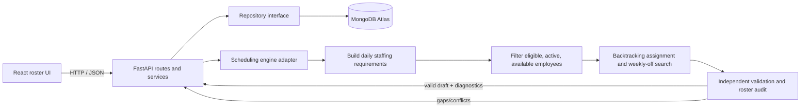

# Smart Roster Management System

A full-stack roster planning app for managing employees, brands, processes, pods, availability, operating rules, and monthly schedules. The React frontend and FastAPI backend live in one repository and can be deployed as two separate services.

## Contents

- [`frontend/`](frontend): React, TypeScript, Vite, Tailwind CSS, React Router, and Axios.
- [`backend/`](backend): FastAPI API, Pydantic schemas, MongoDB repository, and the existing Python scheduling engine with independent validation.

## Features and assessment coverage

- Sample dataset with 32 employees (31 active), 25 brands, 3 processes, and 5 pods.
- Company-wide, pod-wise, brand-wise, process-wise, and employee-wise roster views.
- Configurable brand/process calendars and minimum staffing, employee eligibility, workable weekdays, weekly offs, leave, comp-offs, and public holidays.
- Draft generation, manual assignments and change-impact previews, coverage/conflict diagnostics, validation, regeneration, versioning, and publishing.
- Mandatory rules are validated independently of generation; invalid assignments do not count toward staffing and invalid rosters cannot be published.
- MongoDB Atlas persistence, indexed collections, and an idempotent sample-data seed script.

These features address the supplied assessment brief. The brief in the project instructions describes requirements but does not include the separate PDF questionnaire; add answers to any PDF-specific questions when that questionnaire is available.

## Architecture



The scheduling engine remains isolated behind an adapter. It derives daily requirements from operating rules, searches eligible employee assignments and weekly offs, then independently validates coverage and constraints before returning a successful roster. The API stores valid draft results and exposes diagnostics for infeasible schedules. Fairness optimization is not implemented; month-boundary weekly-off coordination remains a documented limitation.

## Prerequisites

- Python 3.11 or newer (the backend dependencies support current Python 3 releases).
- Node.js 20 or newer and npm.
- MongoDB Atlas for persistent local/deployed use. The explicit `STORAGE_BACKEND=memory` option is suitable only for temporary local UI work and does not persist data.

## Run locally

### 1. Configure and start the backend

```bash
cd backend
python3 -m venv .venv
source .venv/bin/activate
python -m pip install -r requirements.txt
cp .env.example .env
```

Edit `backend/.env` and set `MONGODB_URI` to the Atlas connection string. Set `MONGODB_DATABASE=smart_roster_dev` and keep `STORAGE_BACKEND=mongodb`. Configure Atlas Network Access for your development machine and URL-encode any special characters in the database username or password. Keep `.env` private; it is ignored by Git.

Seed the bundled valid sample data, then start FastAPI:

```bash
python -m app.scripts.seed_database
python -m uvicorn app.main:app --reload
```

The API is available at `http://localhost:8000`; Swagger docs are at `http://localhost:8000/docs`, liveness at `/api/v1/health`, and database readiness at `/api/v1/ready`.

Optional conflict fixture (kept in its own database):

```bash
python -m app.scripts.seed_database --scenario conflict --database smart_roster_conflict_test
```

The valid seed operation is additive and idempotent. Do not use the explicit `--reset` flag unless you intend to clear the named development/test database.

### 2. Start the frontend

In another terminal:

```bash
cd frontend
npm ci
cp .env.example .env
npm run dev
```

The Vite development server prints its local URL (normally `http://localhost:5173`). Set `VITE_API_BASE_URL` in `frontend/.env` if the API is hosted elsewhere; its default is `http://localhost:8000/api/v1`.

## Tests and production build

```bash
cd backend
source .venv/bin/activate
pytest -q
python -m unittest discover -s app/scheduling_engine/tests -v
```

MongoDB integration tests require `MONGODB_TEST_URI` and use only the dedicated `smart_roster_test` database. See [`backend/README.md`](backend/README.md) for details.

```bash
cd frontend
npm ci
npm run typecheck
npm test
npm run build
```

## Deploy from the same GitHub repository

### Backend on Render

The root [`render.yaml`](render.yaml) is a Render Blueprint for the FastAPI service. In Render, create a **Blueprint** from this repository, review the `smart-roster-api` web service, and provide the secret `MONGODB_URI` when prompted. The service uses the `backend/` root directory, installs `requirements.txt`, and starts Uvicorn on Render's assigned port. Set `SMART_ROSTER_ALLOWED_FRONTEND_ORIGINS` to the deployed Vercel origin after creating the frontend deployment (for example, `https://your-project.vercel.app`, with no trailing slash).

Render's free web services can sleep after inactivity and may take time to wake. Set `MONGODB_URI` only in Render's environment settings; never commit it. The Atlas database user needs least-privilege access to `smart_roster_dev`, and Atlas Network Access must allow connections from the Render service. For production, use an appropriate paid/static-egress setup rather than broadly opening database access.

### Frontend on Vercel

1. Import the same GitHub repository into Vercel.
2. Set **Root Directory** to `frontend` and keep the Vite build command `npm run build` and output directory `dist`.
3. Add `VITE_API_BASE_URL=https://<your-render-service>.onrender.com/api/v1` as a Vercel environment variable, then redeploy.
4. Add the Vercel origin to Render's `SMART_ROSTER_ALLOWED_FRONTEND_ORIGINS` and redeploy the backend.

[`frontend/vercel.json`](frontend/vercel.json) routes client-side paths to the React application entry point. Do not put database credentials in frontend environment variables; Vite variables are public in the built client.

### Environment variable summary

| Service | Variable | Purpose |
|---|---|---|
| Render | `MONGODB_URI` | Secret Atlas connection string |
| Render | `MONGODB_DATABASE` | Database name, normally `smart_roster_dev` |
| Render | `STORAGE_BACKEND` | Use `mongodb` for persistence |
| Render | `SMART_ROSTER_ALLOWED_FRONTEND_ORIGINS` | Allowed Vercel origin(s), comma-separated |
| Vercel | `VITE_API_BASE_URL` | Public FastAPI base URL ending in `/api/v1` |

## Assessment response outline

- **How are schedules created?** Rules and staffing levels are expanded into daily requirements; the scheduling engine finds eligible, active, available employees and weekly offs, then checks the result with an independent validator and audit.
- **How are conflicts handled?** Coverage gaps and rule violations are returned as diagnostics; invalid manual edits are rejected, invalid assignments do not satisfy staffing, and invalid rosters cannot be published.
- **How does the system adapt to changes?** Employees, eligibility, leave, holidays, operating calendars, and staffing rules are managed through the API/UI and persisted in MongoDB rather than being hardcoded in React.
- **What are the main limitations?** Fairness optimization is out of scope; coordination of weekly offs across month boundaries is not implemented. A conflict scenario is seeded into a separate database to avoid contaminating valid development data.
- **What remains for submission?** Configure public deployment URLs, run the final assessment-specific checks, add answers to any separate PDF questionnaire, and record the requested 3–5 minute demo.

## Repository safety

`.env`, virtual environments, Python caches, `node_modules`, and build outputs are excluded from source control. Use `.env.example` files as templates and rotate any credential that was accidentally shared or committed.
