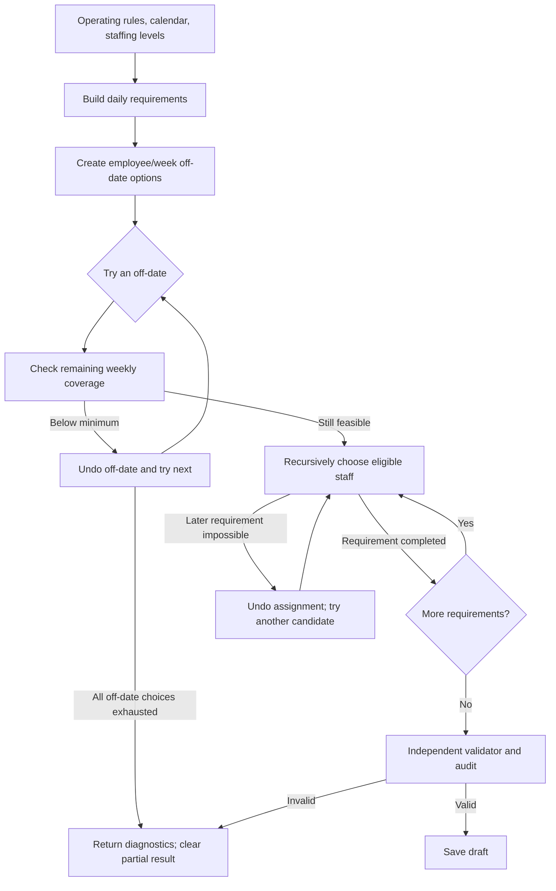

# Smart Roster Management System

A full-stack roster planning app for managing employees, brands, processes, pods, availability, operating rules, and monthly schedules. The React frontend and FastAPI backend live in one repository and can be deployed as two separate services.

GitHub repository: [Anas-Nevrekar/Smart_Roster_Management_System](https://github.com/Anas-Nevrekar/Smart_Roster_Management_System)

## Contents

- [`frontend/`](frontend): React, TypeScript, Vite, Tailwind CSS, React Router, and Axios.
- [`backend/`](backend): FastAPI API, Pydantic schemas, MongoDB repository, and the existing Python scheduling engine with independent validation.

## Features and assessment coverage

- Sample dataset with 32 employees (31 active), 25 brands, 3 processes, and 5 pods.
- Company-wide, pod-wise, brand-wise, process-wise, and employee-wise roster views.
- Configurable brand/process calendars and minimum staffing, employee eligibility, workable weekdays, weekly offs, leave, comp-offs, and public holidays.
- Draft generation, manual assignments and change-impact previews, coverage/conflict diagnostics, validation, regeneration, versioning, and publishing.
- Mandatory rules are validated independently of generation; invalid assignments do not count toward staffing and invalid rosters cannot be published.
- MongoDB Atlas persistence, indexed collections, and an idempotent sample-data seed script.

These features address the supplied assessment brief. The brief in the project instructions describes requirements but does not include the separate PDF questionnaire; add answers to any PDF-specific questions when that questionnaire is available.

## Problem and solution

The scheduling problem is to staff every operating brand/process on every required date while meeting that combination's minimum staffing level. Each employee has a limited set of eligible brand/process combinations and may also be unavailable because they are inactive, do not work that weekday, have approved leave/comp-off, or have a weekly off. A choice that looks valid for today's requirement can leave a later brand/process without enough eligible people. Manual edits and changes to availability or operating rules can also create indirect coverage gaps elsewhere in the month.

A simple greedy pass can get trapped by early choices: it fills one requirement with an available person, then discovers that the same person was the only feasible choice for a later requirement. This system searches alternate choices. Its recursive backtracking engine tentatively assigns weekly offs and staff, checks whether the remaining work is still feasible, and undoes a decision when it leads to a dead end. The result is accepted only after a separate validator and audit confirm coverage and mandatory rules.

## Scheduling algorithm

The engine is implemented in `backend/app/scheduling_engine/`; FastAPI calls it through `backend/app/integrations/roster_engine/`. The process is:

1. **Expand operating rules into daily demand.** `preprocessing.build_daily_requirements` walks each date in the requested month. For every active brand/process rule whose brand and process are active, it creates a requirement with that date and `minimum_staffing`. Ordinary dates follow the rule's operating weekdays. On public holidays, the rule's `public_holiday_policy` decides whether it operates.
2. **Create weekly-off search tasks.** For every active employee and each Monday-to-Sunday calendar week intersecting the month, the engine collects workable dates that do not overlap approved leave/comp-off. It tries dates with fewer staffing requirements first, and employees with fewer possible off dates first. Boundary weeks include days outside the month; separate month runs are not coordinated with each other.
3. **Prune off-day choices that make coverage impossible.** After tentatively choosing an employee's weekly off, the engine checks each requirement in that week. Candidate employees must be active, eligible for that brand/process, workable on that weekday, not on approved time off, not already off, and not already assigned to that same brand/process on that date. If fewer candidates remain than required staff, this branch is abandoned immediately.
4. **Recursively assign staff to requirements.** Once a complete weekly-off plan passes the weekly checks, the engine visits each daily requirement in order. It recursively selects exactly the required number of valid candidates. Different process assignments for the same employee/day are allowed; duplicate employee/date/brand/process assignments are rejected.
5. **Backtrack when a later requirement fails.** If no candidate combination completes the remaining requirements, `undo_assignment` removes the latest tentative assignment and the search tries another candidate. If all candidate combinations fail under the current off plan, `undo_weekly_off` removes the latest off choice and tries another date. This continues until a complete roster is found or all explored branches fail.
6. **Validate and audit independently.** The isolated engine worker checks the final assignments with `validator.validate_roster` and `roster_audit.audit_roster`. A result is successful only when the search succeeds and both checks are clean. Failed searches clear partial assignments and return diagnostics; invalid assignments do not count toward coverage and invalid rosters cannot be published.

Backtracking provides a feasibility search, not a fairness score: there is no objective function that ranks otherwise valid rosters by employee preference or fairness. Its worst-case search time grows exponentially with the number of interacting choices. Candidate ordering and weekly coverage pruning reduce avoidable exploration, but cannot eliminate that worst case. When no roster is found, diagnostics distinguish directly proven shortages (such as no eligible staff or insufficient available staff) from an exhausted combined search where no single requirement can be named as the unique cause.



Core implementation: `preprocessing.py` builds demand; `candidate_selection.py` filters candidates; `backtracking.py` searches and undoes branches; `assignment.py` enforces assignment rules; `weekly_off.py` tracks weekly offs; `validator.py` and `roster_audit.py` independently verify results. The engine adapter and worker isolate execution from the API process.

## Architecture

The React client calls the FastAPI routes over HTTP/JSON. API routes delegate business operations to services, which use a repository interface backed by MongoDB Atlas. Roster generation snapshots master data and invokes the scheduling-engine adapter/worker. The engine returns valid assignments or diagnostics to the management service, which persists drafts, versions, and publish state.

## Prerequisites

- Python 3.11 or newer (the backend dependencies support current Python 3 releases).
- Node.js 20 or newer and npm.
- MongoDB Atlas for persistent local/deployed use. The explicit `STORAGE_BACKEND=memory` option is suitable only for temporary local UI work and does not persist data.

## Run locally

### 1. Configure and start the backend

```bash
cd backend
python3 -m venv .venv
source .venv/bin/activate
python -m pip install -r requirements.txt
cp .env.example .env
```

Edit `backend/.env` and set `MONGODB_URI` to the Atlas connection string. Set `MONGODB_DATABASE=smart_roster_dev` and keep `STORAGE_BACKEND=mongodb`. Configure Atlas Network Access for your development machine and URL-encode any special characters in the database username or password. Keep `.env` private; it is ignored by Git.

Seed the bundled valid sample data, then start FastAPI:

```bash
python -m app.scripts.seed_database
python -m uvicorn app.main:app --reload
```

The API is available at `http://localhost:8000`; Swagger docs are at `http://localhost:8000/docs`, liveness at `/api/v1/health`, and database readiness at `/api/v1/ready`.

Optional conflict fixture (kept in its own database):

```bash
python -m app.scripts.seed_database --scenario conflict --database smart_roster_conflict_test
```

The valid seed operation is additive and idempotent. Do not use the explicit `--reset` flag unless you intend to clear the named development/test database.

### 2. Start the frontend

In another terminal:

```bash
cd frontend
npm ci
cp .env.example .env
npm run dev
```

The Vite development server prints its local URL (normally `http://localhost:5173`). Set `VITE_API_BASE_URL` in `frontend/.env` if the API is hosted elsewhere; its default is `http://localhost:8000/api/v1`.

## Backend API reference

All API paths below are prefixed with `/api/v1`. JSON request/response schemas and interactive examples are available at `http://localhost:8000/docs` during development (or at the deployed API's `/docs` if enabled). Successful responses use JSON; resource lists commonly return `data` and `total`. Validation and business errors use the API's structured error response.

### Health

| Method | Path | Purpose |
|---|---|---|
| GET | `/api/v1/health` | Process liveness check. |
| GET | `/api/v1/ready` | Readiness check, including MongoDB connectivity/index readiness when MongoDB is enabled. |

### Employees

| Method | Path | Purpose |
|---|---|---|
| GET | `/api/v1/employees` | List employees. Optional filters: `pod_id`, `is_active`, `search`. |
| POST | `/api/v1/employees` | Create an employee. |
| GET | `/api/v1/employees/{entity_id}` | Fetch one employee. |
| PUT | `/api/v1/employees/{entity_id}` | Replace an employee's editable fields. |
| PATCH | `/api/v1/employees/{entity_id}/status` | Activate or deactivate an employee. |
| GET | `/api/v1/employees/{entity_id}/eligibility` | List the employee's eligible brand/process combinations. |
| PUT | `/api/v1/employees/{entity_id}/eligibility` | Replace the employee's eligibility set. |
| GET | `/api/v1/employees/{entity_id}/availability` | Get workable weekdays and time-off records. |
| PUT | `/api/v1/employees/{entity_id}/availability` | Update recurring availability. |

### Pods

| Method | Path | Purpose |
|---|---|---|
| GET | `/api/v1/pods` | List pods. |
| POST | `/api/v1/pods` | Create a pod. |
| GET | `/api/v1/pods/{entity_id}` | Fetch one pod. |
| PUT | `/api/v1/pods/{entity_id}` | Replace a pod's editable fields. |
| DELETE | `/api/v1/pods/{entity_id}` | Delete or deactivate a pod, subject to references. |
| PATCH | `/api/v1/pods/{entity_id}/lead` | Set the pod lead. |
| GET | `/api/v1/pods/{entity_id}/employees` | List pod members. |
| PUT | `/api/v1/pods/{entity_id}/employees` | Replace pod membership. |

### Brands and processes

| Method | Path | Purpose |
|---|---|---|
| GET | `/api/v1/brands` | List brands. |
| POST | `/api/v1/brands` | Create a brand. |
| GET | `/api/v1/brands/{entity_id}` | Fetch one brand. |
| PUT | `/api/v1/brands/{entity_id}` | Replace a brand's editable fields. |
| PATCH | `/api/v1/brands/{entity_id}/status` | Activate or deactivate a brand. |
| GET | `/api/v1/brands/{entity_id}/employees` | List employees eligible for the brand. |
| GET | `/api/v1/brands/{entity_id}/processes` | List processes configured for the brand. |
| GET | `/api/v1/processes` | List processes. |
| POST | `/api/v1/processes` | Create a process. |
| GET | `/api/v1/processes/{entity_id}` | Fetch one process. |
| PUT | `/api/v1/processes/{entity_id}` | Replace a process's editable fields. |
| PATCH | `/api/v1/processes/{entity_id}/status` | Activate or deactivate a process. |

### Eligibility

| Method | Path | Purpose |
|---|---|---|
| GET | `/api/v1/eligibility` | List eligibility records. Optional filters: `employee_id`, `brand_id`, `process_id`. |
| POST | `/api/v1/eligibility` | Create an eligibility record. |
| PUT | `/api/v1/eligibility/{entity_id}` | Replace an eligibility record. |
| DELETE | `/api/v1/eligibility/{entity_id}` | Delete an eligibility record. |
| GET | `/api/v1/brands/{brand_id}/eligibility` | List eligibility records for a brand. |

### Operating rules

| Method | Path | Purpose |
|---|---|---|
| GET | `/api/v1/operating-rules` | List brand/process calendars and staffing rules. |
| POST | `/api/v1/operating-rules` | Create an operating rule. |
| GET | `/api/v1/operating-rules/{entity_id}` | Fetch one operating rule. |
| PUT | `/api/v1/operating-rules/{entity_id}` | Replace an operating rule. |
| DELETE | `/api/v1/operating-rules/{entity_id}` | Delete an operating rule. |

### Time off and holidays

| Method | Path | Purpose |
|---|---|---|
| GET | `/api/v1/time-off` | List requests. Optional filters: `employee_id`, `status`, `time_off_type`, `start_date`, `end_date`. |
| POST | `/api/v1/time-off` | Create a time-off or comp-off request. |
| GET | `/api/v1/time-off/{entity_id}` | Fetch one request. |
| PUT | `/api/v1/time-off/{entity_id}` | Replace a request. |
| PATCH | `/api/v1/time-off/{entity_id}/approve` | Approve a request; optional query parameter `approved_by`. |
| PATCH | `/api/v1/time-off/{entity_id}/reject` | Reject a request. |
| DELETE | `/api/v1/time-off/{entity_id}` | Delete a request. |
| GET | `/api/v1/public-holidays` | List public holidays; optional `year` filter. |
| POST | `/api/v1/public-holidays` | Create a public holiday. |
| GET | `/api/v1/public-holidays/{entity_id}` | Fetch one public holiday. |
| PUT | `/api/v1/public-holidays/{entity_id}` | Replace a public holiday. |
| DELETE | `/api/v1/public-holidays/{entity_id}` | Delete a public holiday. |

### Rosters and assignments

| Method | Path | Purpose |
|---|---|---|
| POST | `/api/v1/rosters/generate` | Generate and save a monthly draft; body supplies `month`, `year`, and optional `generated_by`. |
| POST | `/api/v1/rosters/{roster_id}/regenerate` | Regenerate an existing draft from current master data. Optional `If-Match` header supplies the expected version. |
| GET | `/api/v1/rosters` | List saved rosters; optional `month`, `year`, and `status` (`draft` or `published`) filters. |
| GET | `/api/v1/rosters/{roster_id}` | Fetch roster metadata and summary. |
| GET | `/api/v1/rosters/{roster_id}/assignments` | List assignments; optional filters `employee_id`, `brand_id`, `process_id`, `pod_id`, `start_date`, `end_date`, and `status`. |
| POST | `/api/v1/rosters/{roster_id}/assignments` | Add a working assignment. Requires current version in `If-Match`. |
| PATCH | `/api/v1/rosters/{roster_id}/assignments/{assignment_id}` | Update an assignment. Requires current version in `If-Match`. |
| DELETE | `/api/v1/rosters/{roster_id}/assignments/{assignment_id}` | Delete an assignment. Requires current version in `If-Match`. |
| GET | `/api/v1/rosters/{roster_id}/weekly-offs` | List weekly offs; optional filters `employee_id`, `pod_id`, `start_date`, `end_date`. |
| GET | `/api/v1/rosters/{roster_id}/coverage` | Get staffing coverage and gaps. |
| GET | `/api/v1/rosters/{roster_id}/views/company` | Company-wide roster view. |
| GET | `/api/v1/rosters/{roster_id}/views/pod` | Pod-wise roster view. |
| GET | `/api/v1/rosters/{roster_id}/views/brand` | Brand-wise roster view. |
| GET | `/api/v1/rosters/{roster_id}/views/process` | Process-wise roster view. |
| GET | `/api/v1/rosters/{roster_id}/views/employee` | Employee-wise roster view. |
| POST | `/api/v1/rosters/{roster_id}/validate` | Independently validate a saved roster and return diagnostics. |
| POST | `/api/v1/rosters/{roster_id}/publish` | Validate and publish; optional body can provide `published_by`. |
| POST | `/api/v1/rosters/{roster_id}/check-impact` | Preview how proposed master-data changes affect the saved roster; preview does not save changes. |

Roster edit endpoints use optimistic version checks to prevent a stale client from overwriting newer edits. If `If-Match` does not match the current roster version, the API rejects the edit. Regeneration and publishing operate on drafts and preserve the service's validation rules.

Example requests:

```bash
curl http://localhost:8000/api/v1/ready

curl -X POST http://localhost:8000/api/v1/rosters/generate \
  -H 'Content-Type: application/json' \
  -d '{"month":12,"year":2026}'

curl 'http://localhost:8000/api/v1/rosters?month=12&year=2026'
```

## Tests and production build

```bash
cd backend
source .venv/bin/activate
pytest -q
python -m unittest discover -s app/scheduling_engine/tests -v
```

MongoDB integration tests require `MONGODB_TEST_URI` and use only the dedicated `smart_roster_test` database. See [`backend/README.md`](backend/README.md) for details.

```bash
cd frontend
npm ci
npm run typecheck
npm test
npm run build
```

## Deploy from the same GitHub repository

### Backend on Render

The root [`render.yaml`](render.yaml) is a Render Blueprint for the FastAPI service. In Render, create a **Blueprint** from this repository, review the `smart-roster-api` web service, and provide the secret `MONGODB_URI` when prompted. The service uses the `backend/` root directory, installs `requirements.txt`, and starts Uvicorn on Render's assigned port. Set `SMART_ROSTER_ALLOWED_FRONTEND_ORIGINS` to the deployed Vercel origin after creating the frontend deployment (for example, `https://your-project.vercel.app`, with no trailing slash).

Render's free web services can sleep after inactivity and may take time to wake. Set `MONGODB_URI` only in Render's environment settings; never commit it. The Atlas database user needs least-privilege access to `smart_roster_dev`, and Atlas Network Access must allow connections from the Render service. For production, use an appropriate paid/static-egress setup rather than broadly opening database access.

### Frontend on Vercel

1. Import the same GitHub repository into Vercel.
2. Set **Root Directory** to `frontend` and keep the Vite build command `npm run build` and output directory `dist`.
3. Add `VITE_API_BASE_URL=https://<your-render-service>.onrender.com/api/v1` as a Vercel environment variable, then redeploy.
4. Add the Vercel origin to Render's `SMART_ROSTER_ALLOWED_FRONTEND_ORIGINS` and redeploy the backend.

[`frontend/vercel.json`](frontend/vercel.json) routes client-side paths to the React application entry point. Do not put database credentials in frontend environment variables; Vite variables are public in the built client.

### Environment variable summary

| Service | Variable | Purpose |
|---|---|---|
| Render | `MONGODB_URI` | Secret Atlas connection string |
| Render | `MONGODB_DATABASE` | Database name, normally `smart_roster_dev` |
| Render | `STORAGE_BACKEND` | Use `mongodb` for persistence |
| Render | `SMART_ROSTER_ALLOWED_FRONTEND_ORIGINS` | Allowed Vercel origin(s), comma-separated |
| Vercel | `VITE_API_BASE_URL` | Public FastAPI base URL ending in `/api/v1` |

## Assessment response outline

- **How are schedules created?** Rules and staffing levels are expanded into daily requirements; the scheduling engine finds eligible, active, available employees and weekly offs, then checks the result with an independent validator and audit.
- **How are conflicts handled?** Coverage gaps and rule violations are returned as diagnostics; invalid manual edits are rejected, invalid assignments do not satisfy staffing, and invalid rosters cannot be published.
- **How does the system adapt to changes?** Employees, eligibility, leave, holidays, operating calendars, and staffing rules are managed through the API/UI and persisted in MongoDB rather than being hardcoded in React.
- **What are the main limitations?** Fairness optimization is out of scope; coordination of weekly offs across month boundaries is not implemented. A conflict scenario is seeded into a separate database to avoid contaminating valid development data.
- **What remains for submission?** Configure public deployment URLs, run the final assessment-specific checks, add answers to any separate PDF questionnaire, and record the requested 3–5 minute demo.

## Repository safety

`.env`, virtual environments, Python caches, `node_modules`, and build outputs are excluded from source control. Use `.env.example` files as templates and rotate any credential that was accidentally shared or committed.
